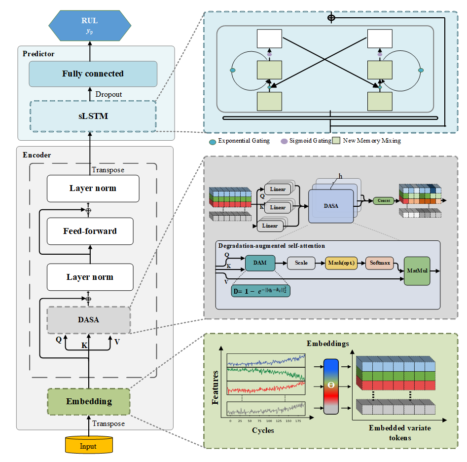
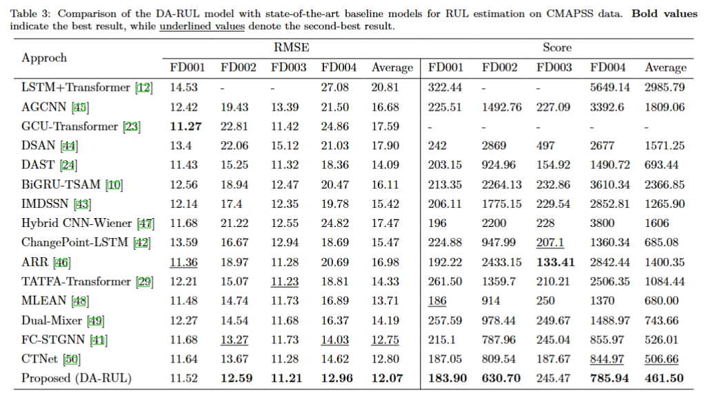

# [Remaining Useful Life Estimation Based on Improved Attention Mechanism](https://www.sciencedirect.com/science/article/pii/S259012302504856X)
Official implementation of the paper: **"Remaining useful life estimation based on improved attention mechanism"** published in *Results in Engineering* (Elsevier).  
**DOI:** [10.1016/j.rineng.2025.108813](https://doi.org/10.1016/j.rineng.2025.108813)

## Overview
We propose the **Degradation-Augmented RUL (DA-RUL)** model, which incorporates distance-based similarity measures into the self-attention mechanism to emphasize geometrically significant variations. By augmenting these sequences, the model is better able to focus on critical degradation events, improving overall predictive accuracy. Subsequently, a **sLSTM** architecture is employed to capture both temporal and local dependencies within the data. 

<p align="center">
  
</p>

## Main Results
We compared our model with 14 baselines, including **Dual_Mixer**, **FC-STGNN**, and **CTNet**. Experimental results confirm that **DA-RUL achieves State-of-the-Art (SOTA)** performance on NASA CMAPSS and XJTU-SY datasets.

<p align="center">
  
</p>

## Requirements
The following dependencies are required to run the code:
- Python 3.8.19
- numpy == 1.24.4
- pandas == 1.5.3
- scikit-learn == 0.24.0
- torch == 1.8.2+cu111
- pytorch-lightning == 1.1.4

```bash
pip install -r requirements.txt
```

## Data
The `--dataset-root` should be updated according to your data folder. 

The data can be downloaded here.
-NASA CMAPSS Jet Engine Simulated Data: (https://data.nasa.gov/Aerospace/CMAPSS-Jet-Engine-Simulated-Data/ff5v-kuh6/about_data)
### Train & Evaluate
```
python ./train_script/lightning_cmapss_FD001.py --dataset-root /your/path/to/CMAPSS --sub-dataset FD001
```
### Test & Evaluate with trained models
```
python ./test_script/FD001_Test.py --dataset-root /your/path/to/CMAPSS --sub-dataset FD001
```
## Citation
If you find this research or code useful for your work, please cite our paper:
```
@article{ABBAS2026108813,
  title = {Remaining useful life estimation based on improved attention mechanism},
  journal = {Results in Engineering},
  volume = {29},
  pages = {108813},
  year = {2026},
  issn = {2590-1230},
  doi = {10.1016/j.rineng.2025.108813},
  url = {[https://doi.org/10.1016/j.rineng.2025.108813](https://doi.org/10.1016/j.rineng.2025.108813)},
  author = {Zeeshan Abbas and Hao Wang and Mehboob Hussain and Xiaobao Song and Zafar Ali and Wenming Cao},
  keywords = {Remaining useful life, Prognostics and health management, Data-driven prognostic, Degradation augmented self-attention, Aero-engine}
}
```
## Acknowledgement
We appreciate the following GitHub repos a lot for their valuable code and efforts.

- lucidrains (https://github.com/lucidrains/iTransformer)
- LazyLZ (https://github.com/LazyLZ/multi-head-attention-for-rul-estimation)
- muditbhargava66(https://github.com/muditbhargava66/PyxLSTM)
